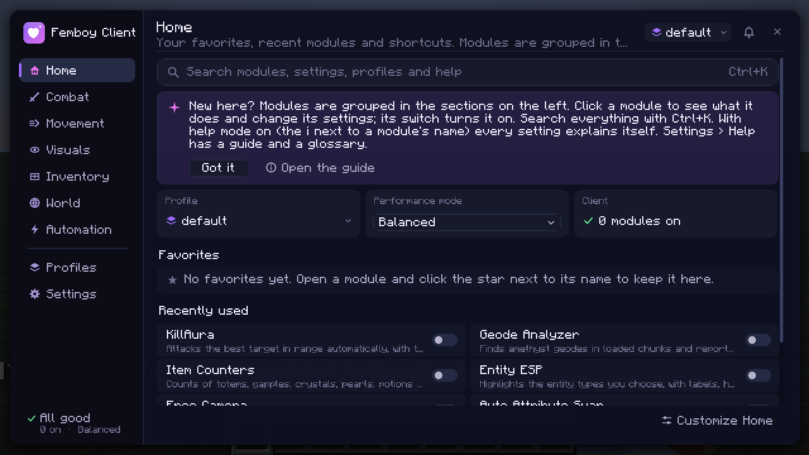

# Femboy Client

A client-side Fabric mod for **Minecraft Java Edition 1.21.11**: a themeable menu with 77 combat, automation, movement, visual, inventory, tracking, world and utility modules, a command palette, ESP with target lines from your crosshair, three performance modes, a Performance Center, a HUD editor with layouts, profiles with previews, history and automatic switching, 24 ready-made presets, rules, a session timeline, and restore points.

Everything is **off on first start**; nothing runs until you turn it on or install a preset. Every module shows a **tier** badge: *Visual* and *Assist* modules (information, ESP, HUD) and *Automation* modules that only manage your own items (Auto Attribute Swap's spear reach and weapon rules, Auto Tool, Inventory Sorter, Chest Organizer, Item Swap, Hotbar Profiles, Sprint) work on every server. **Sandbox** modules (combat automation including AutoCrystal, AutoAnchor and Auto Pot, movement changes including Anti Hunger, Auto Armor, Auto Refill, Auto Offhand, and the three modules that read every loaded block: Block ESP, Block Counter and Geode Analyzer) work only in a **test environment**: singleplayer, or a server you reach at a private address (your own PC, your LAN, or a VPN such as Tailscale or ZeroTier). There are no prompts or allowlists; elsewhere they simply stay off and their description says why. Femboy Client contains nothing that hides it from anti-cheat systems, and some servers' rules forbid clients like this, so check before you use it there.



## Versions

| Component | Version |
|---|---|
| Minecraft | 1.21.11 |
| Fabric Loader | 0.19.5 |
| Fabric API | 0.141.6+1.21.11 |
| Fabric Loom | `net.fabricmc.fabric-loom-remap` 1.18.4 |
| Mappings | Mojang official mappings |
| Gradle | 9.7.1 (wrapper and distribution checksums pinned) |
| Java | 21 for compiling and running the game; Gradle itself needs **JDK 25+** (a Loom 1.18 requirement) |

## Installation (normal Minecraft launcher)

1. Install Fabric Loader 0.19.5 for Minecraft 1.21.11.
2. Put `femboy-client-1.0.0.jar` (from `build/libs/`) and Fabric API 0.141.6+1.21.11 into the profile's `mods` folder.
3. Start the game and press **Right Shift** to open the menu. You can rebind it under Options → Controls → Key Binds → Femboy Client.

Settings live in `config/femboyclient/`:
- `femboyclient.json`: client options, active profile
- `profiles/*.json`: modules, keys and settings per profile, plus the look and performance mode stored with each profile
- `exports/*.json`: profiles you exported
- `restore-points/<time>-<label>/`: copies of all of the above (the newest 20)
- `reports/`: diagnostic reports and session timelines you exported
- `profiles/<name>.json.before-repair-<time>`: a profile as it was before invalid values in it were replaced by defaults

Every file is written atomically with a `.bak` copy, on a background thread so the game never waits for the disk. An unreadable file is moved aside as `*.corrupt-<time>`, never deleted, and the client falls back to the backup or to defaults.

**Nothing you saved is dropped silently.** Settings or modules this version does not know (written by a newer version) are kept and written back unchanged. When a value is invalid, it is replaced by its default and the file is first copied as `before-repair`. **Upgrading from 0.9.x:** the configuration moves to schema 3 (profiles also store the HUD layout); the old files are copied into a restore point first.

**Upgrading from 0.8.x:** Ore ESP is now Block ESP. Its settings (blocks, radius, "only exposed", on/off) move over automatically the first time a profile is loaded, also for profiles you import later; the previous file stays as `.bak`.

**Upgrading from NOVA:** on first launch, settings from `config/nova/` are copied to `config/femboyclient/`. The old folder is left untouched.

## Building

You need a JDK 25 or newer to run Gradle. The build uses a Java 21 toolchain for compiling and for the game: Gradle finds an installed JDK 21 or downloads one through the foojay resolver.

```bash
export JAVA_HOME=$HOME/.local/share/jdks/jdk-25.0.4.1+1   # any JDK 25+
```

| Task | Command |
|---|---|
| Build the mod jar (also runs the unit tests) | `./gradlew build` → `build/libs/femboy-client-1.0.0.jar` |
| Unit tests only | `./gradlew test` |
| Server GameTests, headless (includes the research experiment) | `./gradlew runGameTest` |
| In-game client tests, headless (needs `xvfb-run`), with screenshots | `./scripts/run-client-tests.sh` |
| Same, in a visible window | `./scripts/run-client-tests.sh --visible` |
| Measure the client's own CPU time and allocations in a fixed scene | `./scripts/run-benchmark.sh` → `build/run/clientGameTest/benchmark.txt` (see [docs/benchmarks](docs/benchmarks/README.md)) |
| Launch a development client to play | `./gradlew runClient` |
| Copy the latest screenshots and reports into `docs/` | `./scripts/collect-artifacts.sh` (run directly after the client tests: other Gradle tasks clear the client run folder) |

## Using the menu

Press **Right Shift**. The sidebar has the module sections **Home, Combat, Movement, Visuals, Inventory, World, Automation** and, below a divider, **Profiles** and **Settings**. Sections that combine several kinds of modules show them as groups you can fold: Visuals has *HUD and utilities*, World has *Search and trackers* and *Developer tools* (folded until opened). The line at the bottom of the sidebar says whether every module is fine ("All good" or "2 modules need a look"; click it for details), how many are on, and the performance mode.

The header has the page title, **Search** (Ctrl+K), the **profile selector**, a **notification bell** and the close button. Keyboard: **Ctrl+K** or **Ctrl+F** search, **Ctrl+1** to **Ctrl+9** jump to a section, **Ctrl+Tab** cycles sections, **Up/Down** move through a module list, **Space** switches the selected module, **Esc** closes an open list first, then the menu.

**Home** is a short overview, not a list of everything: a large search box (typing anywhere on Home starts a search), a getting-started tip until you dismiss it, three small cards (the active profile, the performance mode with a menu to change it, and the client status), your **Favorites**, **Recently used** modules, and **Shortcuts** (Profiles, Edit HUD, Appearance, Help, Settings). **Customize Home** shows or hides each part.

**Module sections** list modules on the left. Each entry shows the module's name, one line saying what it does (or, when something is wrong, what), its key if it has one, a star if it is a favorite, and an on/off switch. The **Show** menu narrows the list: all modules, turned on, favorites, with a key, needs attention, or one kind (shows information, assists, acts for you). Clicking a module opens its panel on the right:
- a fixed header: name, **favorite star**, **help mode** (i) and the **switch**; its section and kind; what it does; its **status in words** (On, Off, Waiting, Not available here, Reduced, On but limited, Restarting, Error) with the reason;
- its **key** (click, press a key; Backspace removes it) and whether it **toggles** or must be **held**; a warning when another module shares the key;
- a live **preview** for ESP modules;
- its settings in sections. The settings before the first named section are under **General**. Less common settings of a section are folded behind **More options**; update rates and limits are in one **Advanced** fold at the end. Click a number to type it exactly; Shift + mouse wheel moves a slider one step; a reset arrow appears next to any changed setting;
- **About this module** (folded): its kind, what it uses, what it cannot run together with, other names it is found by;
- **Reset to defaults** (asks for a second click).

**Help mode** (on by default; the i in a module's header, or Settings › General) shows every setting's explanation, allowed range and default under its name. Off, the list is compact and the explanation appears when you hover. **Settings › Help** has short guides (getting started, finding things, module status, keys, favorites, profiles, backups, the HUD editor, ESP, performance modes, where automation may be used, troubleshooting) and a glossary, with a search field.

The look is a dark panel with a purple accent used sparingly: the selected section, switches that are on, the main button. Text comes in three sizes (titles, body, small print; small print stays full size when the menu is drawn at 1x, where scaled text would be unreadable). Animations are short; **Animations** off makes everything instant and **Reduce motion** keeps only fades. Background glows are off by default (Appearance › Background art). Menu scale: automatic, Minecraft's, or 1x to 4x.

| Section | Contents |
|---|---|
| **Home** | Search, getting-started tip, profile / performance / status cards, favorites, recently used, shortcuts |
| **Combat** | Auto Attribute Swap, Combat Info, Target HUD, Weapon Info, Crystal & Anchor Info, Aim Trainer, Auto Criticals\*, Sprint Reset\*, Auto Weapon Switch\* |
| **Movement** | Free Camera, Sprint, Movement Info, Elytra Info, Flight\*, Elytra Flight\*, Speed\*, Strafe Assist\*, Step\*, Safe Walk\*, No Slow\*, No Fall\*, Anti Hunger\* |
| **Visuals** | Entity ESP, Entity Outlines, Storage ESP, Block ESP\*, Hitboxes, Trajectories, Block Highlight, Light Level, Fullbright, Zoom, Chunk Borders; *HUD and utilities:* Coordinates, Performance, Module List, Keystrokes, Compass, Session Stats, Experience, Notifications, Mention Alerts, Better Chat, Auto Reconnect |
| **Inventory** | Item Counters, Health & Armor, Effects, Auto Tool, Inventory Sorter, Shulker Preview, Item Swap, Hotbar Profiles, Chest Organizer, Auto Armor\*, Auto Refill\* |
| **World** | Geode Analyzer\*, Block Counter\*, Death Coordinates, Structure Finder, Schematic Viewer, Material List, Shape Planner; *Search and trackers:* Player Finder, Trackers, Player Alert, Waypoints; *Developer tools:* Java Runner |
| **Automation** | KillAura\*, Trigger Bot\*, Aim Assist\*, Reach\*, Velocity\*, Auto StunSlam\*, Auto Offhand\*, AutoCrystal\*, AutoAnchor\*, Auto Pot\* |
| **Profiles** | New profile, Import, Back to the previous profile; one card per profile (Preview, Use, and a ⋯ menu: duplicate, rename, export, description, reset or delete); what a profile stores; recently used; the 24 presets; automatic switching |
| **Settings** | **General:** client options (performance mode, menu scale, tooltips, help mode, Home parts, messages), Edit HUD layout, backups (restore points), files, emergency off, reset everything. **Appearance:** Theme Studio. **Performance:** Performance Center. **Rules**, **Timeline**, **Help**. **Developer:** module health, dependencies, configuration validator, crash reports, counters, timings, log |

\* Sandbox tier: test environments only (see [Test environments](#test-environments)).

**Theme Studio** (Settings › Appearance): presets Default purple, Deep violet, Midnight, Minimal dark, High contrast and Reduced motion (and the older Midnight magenta and Deep ocean palettes); your own accent, second accent, background and text colors, panel opacity, corner style (sharp, soft, round), colored or plain icons, background art, HUD background opacity, animation speed, and a live preview. Save looks under a name, copy them as text to share, import them (every value is checked). The look is stored in each profile. Only Minecraft's font is used.

**HUD editor** (Home › Edit HUD, Settings › General, or the search): drag an element; it snaps to the screen edges, the center and other elements with guide lines (hold Shift to place freely; G shows an 8-pixel grid that it then snaps to). The toolbar sits at the top, or at the bottom while an element would be under it at the top. The list on the left has two groups: **Showing** (click a name to select it; the eye hides it in this layout) and **Turned off** (one click turns a HUD module on). The inspector of the selected element has **size**, **opacity**, **hide** and **back to its corner**; **More** adds when it **shows** (always, in combat, out of combat, holding a weapon, gliding, sneaking), **align** buttons (corners, top center, center) and **Settings** (opens the module's own settings, such as its colors). The mouse wheel scales the element under it (Shift: opacity), arrow keys nudge it, Delete or a right-click sends it back to its corner. Overlapping elements are outlined in amber. **Ctrl+Z / Ctrl+Y** undo and redo. Keep several **layouts** (copy, rename, delete, copy to and from the clipboard). Positions are anchored to the nearest screen edge or the center; each profile stores its own layout.

### Search, favorites and the quick wheel

One search finds everything: **Ctrl+K** (or Ctrl+F, Ctrl+P) in the menu, the Search field in the header, the search box on Home, or the **Command palette** key anywhere (unbound by default; bind it under Options › Controls › Key Binds › Femboy Client). Results are grouped by kind:
- **Modules** (Enter opens the module, Tab or a right-click turns it on or off; other names work too, such as "ore esp" or "freecam"),
- **Settings** of any module (opens the module with that setting unfolded, even inside More options or Advanced),
- **HUD elements** (opens the HUD editor with the element selected), **Help** topics, **pages** and **settings tabs**, **profiles** (switch), **theme presets**,
- **Actions:** open the HUD editor, manage profiles, save, create a restore point, go back to the previous profile, cycle the performance mode, add a timeline marker, export a diagnostic report, turn everything off.

With nothing typed it lists favorites, recently used modules and a waiting rule suggestion. **Quick toggle wheel:** bind "Quick toggle wheel (hold)" (unbound by default), hold it in game, point at one of up to eight favorites (then recent modules, then "previous profile") and release.

### Modules

| Module | What it does |
|---|---|
| **Auto Attribute Swap** | Switches to the right weapon for a single hit and straight back: an axe against a raised shield, a mace while falling, optional sword, trident and custom-item rules, and two spear parts: **Spear reach** (click a target beyond your normal reach but within the spear's 4.5 blocks and it jabs with the spear) and **Spear lunge** (hold attack with food or wind charges in hand to jab a Lunge spear again and again and dash; test environments only). Each rule has its own cooldown and conditions. See below. |
| **Combat Info** | Clicks per second (left and right), combo (hits that landed in a row; ends when you take damage), reach of your last hit, accuracy. |
| **Target HUD** | A card with your target's name, health and absorption, armor points, distance, armor and held items, and whether its shield is raised. The target is what you look at, the entity you hit last, or one you lock with the lock key. |
| **Weapon Info** | Depends on what you hold. **Axe:** target shield state, your own shield cooldown. **Mace:** fall distance, smash ready, base smash bonus (same formula as the server), vertical speed, wind charges. **Spear:** Lunge level and why it can't trigger (riding, gliding, in water); while charging, the damage, knockback and dismount windows with the speed you have and need. **Bow/crossbow/trident:** draw, load and charge progress, Riptide conditions, ammunition. |
| **Crystal & Anchor Info** | Highlights obsidian and bedrock within reach where an end crystal can be placed; estimates the explosion damage to you and your target from the crystal, spot or anchor under your crosshair (vanilla formula with exposure, difficulty, armor, Resistance and Protection/Blast Protection); anchor charges and whether it explodes here. |
| **KillAura** | Attacks the best target in range: target filters (players, hostile, passive, teammates, invisible, creative), range, field of view, walls, priority; timing by attack charge or CPS range plus an extra cooldown; turns your view to the target with adjustable speed. |
| **Trigger Bot** | Attacks when your crosshair is on a matching target, with the same filters and timing. |
| **Aim Assist** | Turns your view toward the target nearest your crosshair at an adjustable speed; optionally only while holding attack. Never attacks. |
| **Reach** | Longer attack (+0–3 blocks) and block reach (+0–1). Vanilla servers accept up to +3 and +1; more is rejected by the server. |
| **Velocity** | Keep 0–100% of horizontal and vertical knockback from hits and explosions. |
| **Auto StunSlam** | While falling onto a target with a raised shield: axe hit (disables the shield), mace smash, back to your slot. Minimum fall, delay between hits (0 = same tick), cooldown. |
| **Auto Offhand** | Keeps a totem, shield, golden apple or end crystal in your offhand, with a delay, a health threshold and whether to replace other offhand items. |
| **Auto Criticals** | Jumps when you click a target on the ground so the hit lands while falling (a real critical, no fake packets). |
| **Sprint Reset** | W-tap: releases sprint briefly after a hit so the next hit has sprint knockback again. |
| **Auto Weapon Switch** | Selects the hotbar weapon with the highest attack damage while you look at a living target. |
| **Flight** | Hover-and-move or creative-style flying. Dedicated servers kick flying players unless `allow-flight=true`. |
| **Elytra Flight** | Controlled elytra flight while gliding: forward, up, down and hover, with adjustable speed. |
| **Speed, Strafe Assist, Step, Safe Walk, No Slow, No Fall** | Faster ground movement; air control toward your keys; walk up full blocks (step-height attribute); don't walk off edges; full speed while eating or blocking; no fall damage (tells the server you are on the ground after a set fall distance). |
| **Sprint** | Keeps sprint on while you move forward. Works on every server. |
| **Block ESP** | (Formerly Ore ESP.) Highlights the blocks you choose (ores by default; pick by block or by category: ores, containers and spawners, redstone, plants and wood) within a chunk radius, optionally only those touching air; outline, fill, a color per ore or one color, name and distance labels, target lines. Follows block changes as they happen instead of re-reading chunks. Singleplayer and your own network only (see [Target lines](#esp-and-target-lines)). |
| **Block Highlight, Light Level** | Outlines the block you look at in a chosen color; marks spots where hostile mobs can spawn (block light 0; red now, yellow only at night). |
| **Zoom** | Hold a key to zoom in; scroll to change the zoom; mouse sensitivity drops with the zoom. |
| **Auto Tool** | Selects the best hotbar tool while you mine and switches back afterwards. |
| **Inventory Sorter** | A Sort button in your inventory that orders items by type and amount, merging stacks. |
| **Shulker Preview** | Shows a shulker box's contents in its tooltip. |
| **Auto Armor, Auto Refill** | Equips better armor from your inventory; refills a hotbar stack from the inventory when it runs low. |
| **Block Counter** | Counts chosen blocks around you with scan progress (`Scanned 81/81 chunks`). Singleplayer and your own network only. |
| **Death Coordinates** | Remembers where you died, shows it on the HUD and adds a waypoint. |
| **AutoCrystal** | Places end crystals on obsidian or bedrock next to the target and breaks crystals that hurt it; least target damage, most self damage, never-kill-yourself, place and break delays, switch to crystals, visible turning. |
| **AutoAnchor** | Outside the Nether: places a respawn anchor next to the target, charges it with glowstone and uses it so it explodes; same damage limits; the status line says why no spot works. |
| **Auto Pot** | Throws splash potions at your feet from the hotbar: Healing or Regeneration below a health threshold, and Strength, Speed or Fire Resistance when missing. Your view turns down for the throw and back. |
| **Anti Hunger** | Does not report sprinting to the server, so sprinting costs no hunger (sprint knockback is kept by reporting sprint just before a hit). |
| **Aim Trainer** | Practice targets only you can see; while on, a left click is a shot, not an attack. Rounds with hits, misses, accuracy, reaction time and a best score. |
| **Entity Outlines** | Vanilla's glowing outline (through walls) for players, hostile and passive mobs, items and projectiles, with a color per group. |
| **Item Swap** | Up to three keys that each bring an item to hand (from the hotbar, or swapped in from the inventory); press again to go back. |
| **Hotbar Profiles** | Save hotbar layouts and load them with one click; a layout named like a profile loads when that profile becomes active. |
| **Chest Organizer** | Sort, Stack (put in what the container already has), Store all and Take all buttons on chests, barrels, ender chests and shulker boxes. |
| **Structure Finder** | Nearest villages, strongholds, trial chambers and any other structure type, with the same search as /locate. Singleplayer only: it needs the world seed, which servers never send. |
| **Schematic Viewer, Material List** | Load `.nbt`, `.schem` or `.litematic` files from `config/femboyclient/schematics/`, place them where you stand (with rotation and a layer filter) and see missing and wrong blocks outlined; the Material List shows what is left to place and what you carry. |
| **Keystrokes, Notifications, Better Chat, Auto Reconnect** | WASD, mouse and space display; toasts for module and profile changes; timestamps and stacking of repeated chat lines with longer history; reconnects to the last server after a disconnect, with a delay. |
| **Free Camera** | Fly the camera with its own rotation while your player stays put. Works on servers. See below. |
| **Movement Info** | Speed, vertical speed, fall distance and a landing prediction with the fall damage vanilla would deal (landing block included: water, slime, hay, beds...), red when it would kill you. |
| **Elytra Info** | Speed, height, pitch, elytra durability, rockets, and a warning when your current direction hits a block within a set time. |
| **Entity ESP** | Highlights the entity types you choose (picked by registry id in a searchable checklist), grouped into players, hostile, passive, villagers, items, projectiles and other. Compact labels with separately sized name, distance and health, outlines with real thickness and opacity per group, target lines per group, color overrides for chosen types. See below. |
| **Storage ESP** | Highlights storage blocks you choose by block id, with labels and target lines (choose which kinds of storage get one). Reads only block entities your client has already received; a chest placed or broken nearby updates at once. |
| **Hitboxes** | Entity hitboxes with eye height and look direction (like F3+B), filtered by players, hostile, passive, items, projectiles and others; color, opacity, line width, range. |
| **Trajectories** | The predicted path of arrows (bow and crossbow), tridents, snowballs, eggs, ender pearls, splash/lingering potions and experience bottles, with the landing point and any entity in the way. Uses vanilla's per-tick physics. |
| **Fullbright** | Lights up dark areas without changing your video settings, with adjustable intensity. |
| **Chunk Borders** | Chunk boundary lines around you. |
| **Item Counters** | Counts of the items you choose (totems, gapples, crystals, obsidian, anchors, glowstone, pearls, wind charges, rockets, potions by type...), red when low, and **refill reminders** when an item is in your inventory but not in your hotbar or offhand. |
| **Health & Armor** | Health with absorption, food and saturation, durability of armor and held items, low-health and low-durability warnings with a one-time alert. |
| **Effects** | Active potion effects with level and time left; harmful ones in red, expiring ones highlighted. |
| **Player Finder** | Online players from the server's player list (name, game mode, ping) with search and sorting, plus navigation to players in range and to your waypoints. See below. |
| **Trackers** | Target lines and/or screen-edge arrows to players, mobs, your waypoints and last-seen positions, labelled with where the position comes from. See below. |
| **Player Alert** | Warns you when another player comes within your render distance, and can leave the server for you. See below. |
| **Waypoints** | Save positions; see them as markers with names and distances. |
| **Geode Analyzer** | Finds amethyst geodes in loaded chunks and keeps exact growth-stage counts up to date as chunks load and buds grow. Singleplayer and your own network only. See below. |
| **Coordinates, Performance, Module List** | HUD panels. |
| **Compass** | A heading strip with the directions around where you look and your exact bearing. |
| **Session Stats** | Play time, distance moved, deaths, hits landed, accuracy and best combo of this session. |
| **Experience** | Your level and exactly how many points the next level and a target level need (Minecraft's formulas). |
| **Mention Alerts** | A notification and a short sound when chat mentions your name or one of your keywords as a whole word. Nothing is stored. |
| **Shape Planner** | Outlines a circle, cylinder, sphere, dome, spiral staircase or wall (filled or hollow) around a center you choose, with the number of blocks and stacks. Guides only; it never places blocks. |
| **Java Runner** | Write and run small Java programs in a separate process, with output, errors, limits and examples. See below. |

HUD blocks stack in the corner you choose without overlapping, and the top-right corner starts below vanilla's effect icons.

An enabled module **pauses** while no world is loaded and resumes on its own. If a module throws an error while running, it is **suspended**: stopped, cleaned up and restarted by itself after 5 seconds (10 after a second error). The third error within a minute turns it off until you turn it on again. A notification says which happened, and the module health monitor (Settings → Developer) shows its state, last error and error count. Other modules keep running. The same log message repeated within 10 seconds is counted instead of logged again.

Modules that control the same thing cannot run together: turning one on turns the other off, with a message (KillAura with Aim Assist or Trigger Bot; Flight with Elytra Flight or Speed). When you change world or dimension, modules drop what described the old one (scan results, targets, found structures).

## Performance modes

Settings → Client options → **Performance mode** (also stored in each profile). They change what the client actually does:

| | Performance | Balanced (default) | Low impact |
|---|---|---|---|
| Update and scan intervals of ESP, trackers, light level, storage | x2 | as set | x3 |
| Time a block scan may use per tick | 1 ms | 2.5 ms | 1 ms |
| Highlights, labels and lines drawn | capped (e.g. 48 entities, 150 blocks, 12 labels, 32 lines) | as set | capped |
| HUD text rebuilt | every 2 ticks | every tick | every 2 ticks |
| Menu animations | off | as set | as set |
| Pauses between automatic actions (Auto Offhand, Auto Armor, Auto Refill, Auto Pot, AutoCrystal, AutoAnchor) | as set | as set | x2, at least +250 ms |
| Modules that repeat actions many times a second (KillAura, Trigger Bot, Aim Assist, AutoCrystal, AutoAnchor, Auto Criticals, Auto StunSlam) | run | run | paused, and their status says why |

Low impact means less work and fewer actions. It does not hide anything from a server and makes no claims about anti-cheat.

## ESP and target lines

Entity ESP, Block ESP and Storage ESP are organized the same way: **Targets** (what to highlight and how far), **Highlight** (outline, fill, through walls), **Colors**, **Labels**, **Target lines**, and **Advanced** (update rates and limits). Rarely used options of each section (per-group switches, label spacing, text sizes, override colors) sit behind **More options** in that section. A small **preview** at the top of each ESP module shows a near and a far target with your outline, fill, label, health bar and target lines (color, thickness, opacity, fading); it follows every change at once. It is a drawing in the menu, not a view of the world.

Block ESP, Entity ESP, Storage ESP and Trackers can draw **target lines**: a line from your crosshair to each target, with settings of their own in each module (section "Target lines"):
- **Lines to:** all targets (through walls), only targets on screen, or only targets you can see (a line-of-sight check a few times a second);
- color (each target's highlight color or one custom color), opacity, thickness, fade with distance, hide behind blocks;
- line distance and the most lines (the nearest targets get them).

Entity ESP switches lines per group (players, hostile, passive and pets, villagers, items, projectiles, other); Storage ESP per kind of storage. Lines start on the ray through the middle of the screen of the frame being drawn (the real projection, including view bobbing and field-of-view changes), so they leave exactly from the crosshair at any window size and GUI scale. Targets behind you are reached through the screen edge on their side. Name and distance labels use the same projection, so they stay on their boxes while you walk.

Under the hood the ESP modules share one list of loaded entities (built once per tick), skip boxes outside the view, and update their target lists at their update interval while drawing follows targets every frame. Block ESP reads chunks once, then follows block changes as they happen.

**Where they work:** Entity ESP, Storage ESP and Trackers use only what the server sends for nearby rendering (entities and block entities) and work everywhere. Block ESP, Block Counter and Geode Analyzer read every block of the loaded chunks, which shows what other blocks hide, so they run only in singleplayer and on servers in your own network.

## Profiles and presets

A **profile** stores which modules are on, every setting and every key. Changes save automatically to the active profile.

- **New profile** asks for a name and creates a copy of the current profile (you stay on the current one). **Use** switches to a profile; the current one is saved first, and modules that are off in the new profile are turned off. **Back to ...** returns to the profile you used before.
- Each profile is a card: its name, a check mark and the word **Active** on the active one, and a line describing it (your own **description**, or which modules it turns on). **Preview** lists exactly which modules, keys, settings and stored options would change, with a button to switch.
- The **⋯** menu of a profile: **Duplicate**, **Rename** (switching rules and the history follow), **Export** (to the clipboard and `config/femboyclient/exports/`), **Edit description**, and **Reset to defaults** (active profile) or **Delete** (others). Reset and Delete open a confirmation that says what will be lost; Reset makes a restore point first, Delete keeps a backup of the file.
- **Import** asks for a name and creates a profile from text on the clipboard. Every imported value is checked; unknown modules and invalid values are dropped and replaced by defaults, and you are told which.
- **What does a profile store?**, **Recently used**, **Ready-made presets** and **Automatic switching** are folds on the same page.
- A profile also stores the **look** (Theme Studio), the **performance mode** and the **HUD layout**.
- **Presets:** Sword PvP, Axe PvP, Mace PvP, Spear PvP, Spear + Mace PvP, Crystal PvP, Anchor PvP, Bed PvP, Pot PvP, UHC / Survival, Survival / SMP, Elytra PvP, Bow / Crossbow, Building, Mining, Farming, Exploration, Parkour, Speedrunning, Recording / Streaming, Performance, Developer, Local Testing and Authorized Testing. **Install** creates a normal profile from the preset; edit it like any other. **Reset** puts the preset's settings back. Presets turn on information and visual modules only. Automation that fits a style is configured but left off: Auto Attribute Swap (axe, mace, spear + mace), KillAura and Trigger Bot (sword, axe), Auto StunSlam (mace, spear + mace), AutoTotem (crystal, anchor).
- **Automatic switching:** add rules such as "Mace, any dimension → mace_pvp" (or press **Add rule** next to a preset), then turn on *Switch profiles automatically*. Rules are checked from the top; the first match wins (held item or gliding, optionally a dimension). If nothing matches, the profile stays. A rule result must hold for the **switch delay** (default 4 ticks, 0–40) before the profile changes, so scrolling past items doesn't flicker between profiles. A profile you pick by hand stays until your held item changes to something another rule matches. A weapon Auto Attribute Swap holds for a single hit never changes the profile.

## Restore points and resets

Settings → General → **Restore points**: a copy of all settings and profiles. One is made by hand or automatically before a restore, a full reset, replacing a profile with a preset, and a configuration format update; the newest 20 are kept. **Restore** (two clicks) makes a restore point of the current state first, so it can be undone. **Reset everything** (two clicks) puts client options, the HUD layout, switching rules and every module of the active profile back to a fresh installation's state; other profiles are kept. **Reload from disk** reads the files again after you edited them by hand.

## Performance Center

Settings → **Performance**: FPS, average and slowest frame time, 1% low, a frame-time graph, the share of each frame Femboy Client uses, memory, the cost of every running module (per tick, per HUD frame, per world frame), what busy modules are working on (blocks found, targets, lines), the update rates of the current mode, and warnings with recommendations computed from these numbers (a costly module, a slow frame where Performance mode would help, stutter, memory nearly full). **Compare on and off** measures a visual or assist module for a few seconds in each state under the same conditions and shows the difference in frame time and client cost (automation modules are excluded because switching them on would make them act). **Export report** writes a text report for debugging (versions, frame statistics, module costs and health, recent log; no server address, chat or player names). Allocation measurement can be turned on here; it is off otherwise. Timing is measured around every call into module code all the time; it costs two clock reads per call.

## Rules and timeline

Settings → **Rules**: "When / If / Then" rules. **When:** the profile changes, a world is joined, the dimension changes, the GUI scale or window size changes, FPS stays below a limit for 5 s, combat starts or ends, the held item type changes. **If:** all or any of: the profile is (not) X, the dimension, the environment (singleplayer, private network, public server), what you hold, the HUD layout, FPS below N. **Then:** show a notification, suggest a profile or Performance mode (suggestions wait in the command palette: "Apply suggestion"), switch profile or HUD layout, show or hide a HUD element, turn a *visual* module on or off, set the performance mode, add a timeline marker. Rules run from the top; each has a cooldown and can be a **dry run** that only records what it would do; **Check now** tests the conditions. Problems (missing values, unknown profiles, rules that contradict each other) are listed above the rules, and the history shows what ran. Rules can be copied as text and imported (they arrive switched off). Rules never turn on modules that act in the game, a rule never runs twice in one chain of events, rules that change something wait at least 3 seconds, and at most five rules run per second. Two suggestion-only rules ship by default; "Rules" in the same tab turns the whole system off.

Settings → **Timeline**: this session's profile switches, module changes, worlds and dimensions, deaths, your markers, schematics, performance warnings, module errors and rules. Search, filter by kind, bookmark (bookmarked events are kept longest), add notes, add markers, export as text, clear; choose which kinds are recorded. It is kept in memory (newest 500) and records no chat, no player names and no server addresses.

## Notifications

Client messages go to the bell in the menu. With the **Notifications** module on, they also appear as toasts: choose the position (top right, top left, top center, bottom right), style, icons, duration and which categories show (module toggles, profiles, configuration, errors, performance, environment, rules, alerts, other). The same message within 5 seconds is folded into one with a count, and at most four new toasts appear per second. Turning on a module that cannot run where you are says why instead of pretending it runs.

## Emergency off

**Settings → Turn all modules off**, or a key you bind under Options → Controls → Key Binds → Femboy Client ("Turn all modules off (emergency)", unbound by default). Every module is turned off and restores what it changed (Free Camera returns the view, Fullbright the lighting, Auto Attribute Swap the held item), and automatic profile switching is paused.

## Test environments

Sandbox-tier modules (marked \* above, plus the Spear lunge part of Auto Attribute Swap; this includes Block ESP, Block Counter and Geode Analyzer because they read every loaded block) run only in singleplayer or on a server whose address is private: loopback (`127.x`, `::1`), LAN (`10.x`, `172.16–31.x`, `192.168.x`), link-local, the `100.64–127.x` range used by Tailscale and similar VPNs, and IPv6 unique local addresses. The check uses the address actually connected to, not the name in your server list. To use them on remote test servers, put those servers on a VPN with you. On any other server they show "Only in singleplayer and on servers in your own network (LAN or VPN)" and stay off; you never get a prompt.

Nothing here hides anything from anti-cheat or server checks (no fake rotations, no packet tricks, no anti-kick).

**Not built:** silent (server-only) rotations and anything else that hides what the client does; full block-model ghost rendering in the Schematic Viewer (it draws outlines).

### Geode Analyzer

- **Reads only what your client has.** It never loads chunks or asks the server for anything. Chunks in range that aren't loaded are reported as unavailable, never treated as empty.
- **Updates automatically.** New chunks are read when they load; already-read chunks are re-read after the scan interval; grouping into geodes runs in the background and only when the data actually changed. Reading is limited to a few milliseconds per tick. **Pause** stops reading and analysis while keeping the last results; **Read again** forces a fresh read.
- **Per geode:** distance and direction, completeness, a stage bar, counts per stage (with percentages of the geode's total buds and clusters), the sample size `n`, when the data was read, and an evidence-quality rating (based on completeness and sample size; it is *not* a probability). Click a geode for exact counts, budding faces, unavailable positions and Wilson intervals.
- **Settings:** analysis radius, scan interval, minimum observations, percentage display, listing incomplete geodes, growth-stage display in the world, progress on HUD, debug information, time per tick.
- **Interpretation:** the panel quotes what controlled tests showed (below) and states that growth stages are not evidence of player activity. It never labels a geode as "visited" or similar.

### Player Finder

- The list comes from the server's player list (everyone online, wherever they are).
- **Positions are known only for players within your range**: the server sends a player's position only while they are within its entity tracking range, roughly your render distance. Nothing on the client can see further; that would need the server to share positions.
- Players out of range show **"Position unknown"**, or, if they were in range earlier, **"Last seen … ago"** with that old position, clearly marked as stale. Nothing is inferred or invented. Last-seen positions are forgotten when you change world or dimension.
- Click a player with a known position, or one of your waypoints, to navigate: the HUD shows the target, distance and an arrow relative to where you're looking.

### Player Alert

- Turn it on in World → Player Alert. It warns when a player comes within your range, i.e. when the server starts sending you that player.
- **Settings:** chat message (only you see it), sound, pop-up, warn when they leave (and whether they logged off), ignore NPCs (player-shaped entities missing from the server's player list), and a repeat delay so someone walking along the edge of your range doesn't flood the chat.
- **Auto leave** (off by default): disconnects from a multiplayer server as soon as a player is detected, optionally only within a distance and never for the friends you list. By default it then turns itself off, so rejoining does not make you leave again right away; Auto Reconnect does not bring you back.
- Players already near you when you turn it on are not announced. Several arrivals in the same moment are combined into one message.

### Auto Attribute Swap

**The two spear parts.** A spear jab is its own action, aimed along the spear's attack range (2 to 4.5 blocks in survival, 6.5 in creative). The server checks the jab against your attack charge using the attack speed of the item it last saw you holding; it updates that only when it ticks you. Switching to the spear only for the jab (and back in the same tick) therefore uses the held item's charge time:
- **Spear reach** (any server, like the other rules): when you click and nothing is under the crosshair within your normal reach, but a target is along the spear's range, the module switches to the spear, jabs and switches straight back. Settings: cooldown, target filter.
- **Spear lunge** (singleplayer and servers in your own network only): while you hold attack with one of the "Hold to lunge" items (default: wind charges and common foods; optionally any non-weapon item), it jabs with a spear that has Lunge every cooldown (default 150 ms) and switches back. Items without weapon attack speed recharge in 5 ticks, and the server allows 5 ticks of leeway, so each jab is accepted. Lunge does not work while riding, gliding or in water, costs 1 durability and 4 exhaustion per level per jab, and food drains quickly.


- **What it does:** when you attack, it selects the hotbar slot of a weapon chosen by rule, the attack is sent with that item, and the original slot is selected and sent again in the same tick. The server applies the hit with the swapped item's effects and never sees the swap during its own tick, so your attack charge is kept.
- **Rules,** checked in this order, each in its own card with the item icon, an on/off switch, a reset button and its settings:

  | Rule | Default | Condition | Cooldown |
  |---|---|---|---|
  | Axe | on | only against a raised shield (switchable) | 1000 ms |
  | Mace | on | after falling at least 1.5 blocks | 0 ms |
  | Spear | off | any hit | 500 ms |
  | Sword | off | any hit | 0 ms |
  | Trident | off | any hit | 500 ms |
  | Custom items | off | items you pick from a searchable list | 500 ms |

  Every rule can also be limited to players or to mobs.
- **Global settings:** swap-back delay (0 ticks by default), no swapping while using an item, status on the HUD.
- **Safety:** only hotbar slots are used and nothing is moved in your inventory. A missing item is skipped, a swap is never stacked on one that is still waiting to be undone, and if you change slots yourself during a delayed swap-back your choice is kept.
- **What "confirmed" means:** the panel shows the last swap, which slot was selected and sent, and whether it was held during the hit. Servers don't acknowledge slot changes, so the panel never claims more than that.

### Entity ESP

- **Sections:** Targets, Boxes, Colors, Labels, Health, Target lines, Performance.
- **Labels** are small by default (names at 0.75x). Name, distance and health each have their own on/off switch and size. Background opacity, padding, line spacing, text color and maximum name width (long names end in "...") are adjustable. Names use the group color instead of the old underline. Labels of entities close together stack instead of overlapping.
- **Health** is off by default. When on, it is shown for the groups you choose (players and hostile mobs by default) as a compact bar, a number, or both, with its own size and opacity.
- **Outlines:** thickness (0.5x to 6x), opacity, and an on/off switch per group. The thickness goes into the line shader, so the slider really changes the drawn line.
- **Target lines:** optional lines from your crosshair to highlighted entities, switched per group, with visibility mode, color, opacity, thickness, distance and count (see [ESP and target lines](#esp-and-target-lines)). Your old tracer settings carry over.
- **Color override:** pick entity types to draw in one override color instead of their group color.

### Trackers

- **Display:** target lines from your crosshair (on by default, with all the target-line settings), and/or an arrow at the screen edge for each target that is off screen with a small marker for targets on screen. Labels show the name, distance and source.
- **Sources:**
  - entities your client has loaded (live positions);
  - your waypoints in this world and dimension;
  - Player Finder's last-seen positions, labelled "last seen ... ago".

  Nothing is shown for players that were never in your range.
- **Settings:** target types, maximum distance and number of indicators, update interval, indicator size, distance from the screen edge, labels, distance, label size, opacity, and a color per source.
- Targets that despawn or log off disappear at the next update; removed entities are skipped immediately.

### Free Camera

- **Rotation:** the camera has its own rotation, so the mouse turns the camera and your player's head stays where it was.
- **Keys:** forward, back and sideways use your normal movement keys. Up, down and boost have their own key settings (Space, Left Shift, Left Ctrl by default).
- **Movement settings:** speed, boost multiplier, smoothing, and "fly where you look".
- **On servers:**
  - your player keeps sending its normal position updates, so nothing snaps back when the camera returns;
  - attacking, using items and pick-block are disabled while the camera is detached, because they would aim from the camera.
- **Edge of the loaded area:**
  - the server only sends chunks around your player, so far away there is nothing to show;
  - the HUD says "No world data here" when the camera is there;
  - "Stay inside loaded chunks" stops the camera at the edge instead.
- **Restoring:** occlusion culling is switched off while the camera is detached (inside blocks it would hide everything) and restored afterwards, along with the camera type and the player's input. Dimension changes and respawns re-attach the camera cleanly.

### Java Runner

- **Editor:**
  - code editor with Java syntax highlighting, line numbers, selection, undo, copy, cut, paste and automatic indentation;
  - Run, Stop, Clear and Copy buttons;
  - six examples;
  - status line with the run time;
  - console with errors in red.
- **Never inside Minecraft:** each run starts a separate Java process with a memory limit, a time limit and an output limit, and Stop kills it. The game keeps running normally meanwhile.
- **What code can read:** a read-only snapshot taken when you press Run, through `Femboy.*`:
  - client and Minecraft versions, frame rate, connection;
  - every module's state and settings, recent diagnostics.

  It has no access to the game, your world or other players. Code that tries to use Minecraft classes fails to compile.
- **Code you write:** plain statements (wrapped automatically; `java.util.*` is imported) or a class with `main`. Errors show the line you typed.
- **Confirmation:** code that deletes or writes files, starts programs, uses the network, exits the process or bypasses access checks needs an extra confirmation before it runs. This is a safety prompt, not a sandbox: the process runs with your normal permissions.
- **A JDK is needed:** the runner needs a Java with a compiler. If the Java Minecraft runs on has none (the launcher's often doesn't), set "Java for the runner" to a JDK 21+.

## Research background

The Geode Analyzer grew out of controlled experiments run by `./gradlew runGameTest`. Full report: [docs/research/evaluation.md](docs/research/evaluation.md).

- **Setup:** vanilla geodes in a flat test world, growth simulated with the game's own random-tick code, scored on held-out geodes against criteria fixed before the experiment.
- **Results:**
  - The cluster share separated under 2 h from 2 h+ of simulated ticking. The current report shows 2.2% false positives and 2.9% false negatives on 194 held-out samples; across three runs, the ranges were 2–7% and 3–5%.
  - It cannot separate 5–24 h from longer: the share saturates near 100% after about 6 h.
  - World generation already places clusters, so "any cluster" is not informative (87% false positives).
  - Harvesting resets the share.

None of this identifies players. It describes simulated ticking in test worlds.

## Project layout

```
src/main/java/.../femboyclient/core/     plain Java: settings, modules, config, diagnostics, research, Java Runner process (unit-tested)
src/main/java/.../femboyclient/world/    shared Minecraft code: geode fixtures, census, server scan, experiment generator
src/client/java/.../femboyclient/client/ client: entrypoint, GUI, HUD, rendering, modules, mixins
src/gametest/java/                       server GameTests and in-game client tests
src/test/java/                           JUnit tests
tools/make_icons.py                      generates the GUI icon atlas (vector glyphs, 32 px cells)
tools/make_gui_art.py                    generates the menu's smooth-shape textures and the logo
scripts/                                 test runner, benchmark and artifact collection
docs/                                    screenshots, test reports, research reports, benchmarks, verification report
```

Adding a module means writing one class (settings are declared as fields) and one line in `ModuleRegistry`. The GUI builds its page entry, settings panel and persistence from the module's category and settings.

Mixins (each documented in its source file), among them:
- **`KeyboardHandlerMixin`:** module key binds. Fabric API has no in-world key event, and polling once per tick misses short taps.
- **`GameRendererMixin`:** hides the first-person hand while the free camera is active.
- **`LocalPlayerMixin`:** keeps your player sending position updates while the free camera is active (vanilla stops them whenever another entity is the camera).
- **`MinecraftMixin`:** blocks attack, use and pick-block while the free camera is active, since vanilla would aim them from the camera.
- **`MouseHandlerMixin`:** sends mouse movement to the free camera instead of the player.
- **`LightTextureMixin`:** Fullbright's brightness, applied to the lightmap only (the video setting is never written).
- **`MultiPlayerGameModeMixin`** and **`MultiPlayerGameModeAccessor`:** Auto Attribute Swap's slot change around one attack.
- **`LevelRendererMixin`:** copies the frame's real view and projection matrices (read-only), so labels and target lines match the drawn world.
- **`ClientLevelMixin`:** forwards single block changes to the block scanners (Block ESP, Block Counter), which then update just that block.
- **`EntityRendererMixin`:** Entity Outlines' color per group.

## Documentation

- [docs/VERIFICATION.md](docs/VERIFICATION.md): what was verified, how, and what wasn't.
- [KNOWN_ISSUES.md](KNOWN_ISSUES.md): known limitations and unverified assumptions.
- [CHANGELOG.md](CHANGELOG.md)

## License

Not decided yet (`All-Rights-Reserved` in `fabric.mod.json` until the author chooses one).
