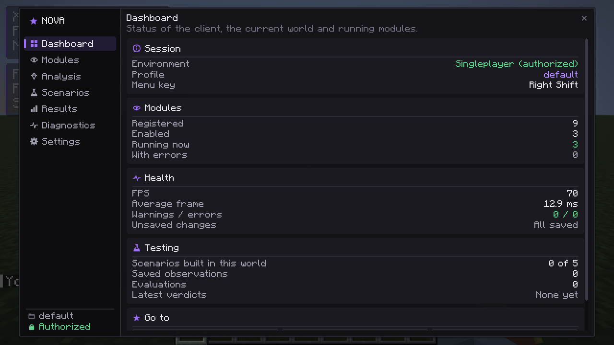

# NOVA

A client-side Fabric mod for **Minecraft Java Edition 1.21.11**, built in two parts:

- **The client:** a module system with a ClickGUI, HUD and world overlays.
- **A research lab:** controlled experiments on whether amethyst growth stages tell you anything about how long a chunk was simulated.

Research and visualization tools are limited to **singleplayer worlds and servers you explicitly authorize** (Settings → Authorized test servers). NOVA does not locate other players' bases and contains nothing that hides it from anti-cheat systems.



## Versions

Verified 2026-10-13 against meta.fabricmc.net and the official `fabric-example-mod` 1.21.11 branch.

| Component | Version |
|---|---|
| Minecraft | 1.21.11 (the last release that still needs remapping) |
| Fabric Loader | 0.19.5 |
| Fabric API | 0.141.6+1.21.11 |
| Fabric Loom | `net.fabricmc.fabric-loom-remap` 1.18.4 (the template's `1.18-SNAPSHOT` line, pinned to its newest release) |
| Mappings | Mojang official mappings (same as the template) |
| Gradle | 9.7.1 (wrapper and distribution checksums pinned) |
| Java | 21 for compiling and running the game; Gradle itself needs **JDK 25+** (a Loom 1.18 requirement) |

## Requirements

- A JDK 25 or newer to run Gradle. The build uses a Java 21 toolchain for compiling and for the game.
  - Gradle finds an installed JDK 21 on its own, or downloads one automatically through the foojay toolchain resolver.
  - On the development machine both JDKs are in `~/.local/share/jdks/`. `~/.gradle/gradle.properties` points Gradle at the JDK 21 there with `org.gradle.java.installations.paths=...`.
- For headless in-game tests on Linux: `xvfb-run` (Xvfb with Mesa).

```bash
export JAVA_HOME=$HOME/.local/share/jdks/jdk-25.0.4.1+1   # any JDK 25+
```

## Commands

| Task | Command |
|---|---|
| Build the mod jar (also runs unit tests) | `./gradlew build` → `build/libs/nova-0.1.0.jar` |
| Unit tests only (49 tests) | `./gradlew test` |
| Server GameTests, headless (6 tests, includes the full research experiment) | `./gradlew runGameTest` |
| In-game client tests, headless (59 checks, screenshots) | `./scripts/run-client-tests.sh` |
| Same, in a visible window | `./scripts/run-client-tests.sh --visible` |
| Launch a development client to play | `./gradlew runClient` |
| Copy the latest screenshots and reports into `docs/` | `./scripts/collect-artifacts.sh` |

Where the results go:
- **Client tests:** the check list is in `build/run/clientGameTest/nova-test-report.txt` and screenshots are in `build/run/clientGameTest/screenshots/`. The full Gradle log of each run is in `build-logs/`.
- **Server GameTests:** the research report goes to `build/run/gameTest/nova-research/`.

## Installation (normal Minecraft launcher)

1. Install Fabric Loader 0.19.5 for Minecraft 1.21.11.
2. Put `nova-0.1.0.jar` from `build/libs/` and Fabric API 0.141.6+1.21.11 into the `mods` folder.
3. Start the game and press **Right Shift** to open NOVA. You can rebind it under Options → Controls → Key Binds → NOVA.

Settings live in `config/nova/`:
- `nova.json`
- `profiles/*.json`
- `fixtures.json`
- `research/` (observations, ground truth and reports)

Every file is written atomically with a `.bak` copy. An unreadable file is moved aside as `*.corrupt-<time>`, never deleted, and NOVA falls back to the backup or to defaults.

## Using NOVA

| Page | What it does |
|---|---|
| Dashboard | Session status (environment, profile, menu key), module counts, health, testing summary, shortcuts |
| Modules | Search and category filter; per-module on/off switch, key bind (click and press a key; Backspace clears), settings with tooltips and per-setting reset, module reset |
| Analysis | Amethyst Geode Analyzer: scan with progress and cancel, geode list, growth-stage chart, observation details, statistical estimates, save observation and open its report |
| Scenarios | Build or remove reproducible test fixtures in a singleplayer world |
| Results | Saved observations, research evaluations (with an in-world quick experiment) and the indicator registry |
| Diagnostics | FPS, frame-time graph, per-module time cost, message log with filter |
| Settings | Profiles (create, switch, delete with confirmation), client options (menu scale, animations, tooltips), authorized test servers, config folder |

| Module | Category | Runs |
|---|---|---|
| Coordinates, Performance, Module List | HUD | everywhere |
| Waypoints, Chunk Borders | Visual | everywhere (your own data only) |
| Fixture ESP, Fixture Containers | Visual | singleplayer / authorized servers; only fixtures that NOVA's scenarios registered |
| Free Camera | Utility | singleplayer / authorized servers |
| Amethyst Geode Analyzer | World Analysis | singleplayer / authorized servers |

An enabled module **pauses** when its environment doesn't allow it (for example, no world is loaded or the server isn't authorized), and resumes automatically. If a module throws an error, it is turned off and reported under Diagnostics; other modules keep running.

## Research summary

Full report: [docs/research/evaluation.md](docs/research/evaluation.md). It was produced headlessly by `./gradlew runGameTest`.

- **Data:** 606 observations (596 complete) of 52 vanilla geodes built with Minecraft's own worldgen feature.
- **Growth:** applied with the game's own random-tick code.
- **Scoring:** on held-out geodes, against criteria fixed in code before any experiment ran.

| Hypothesis | Verdict (tested environment only) |
|---|---|
| H1: the share of clusters among all growth objects separates under 2 h from 2 h+ of random ticking | Supported: precision 97.1%, recall 96.1%, false-positive rate 3.3%, false-negative rate 3.9% (194 held-out samples) |
| H1b: same, using clusters / (large buds + clusters) | Supported |
| H2: the share separates 5–24 h from 24 h+ | Unsupported (chance level: the share saturates near 100% after about 6 h) |
| H3: "any cluster means at least 30 minutes" | Unsupported (false-positive rate 87%: world generation already places clusters) |

Findings computed from the data:
- **The share is not monotonic.** It *drops* during the first 10–20 random ticks, as new small buds dilute it.
- **Harvesting misleads.** Harvesting plus 30 minutes of regrowth makes long-exposed geodes look young.
- **Ticking ≠ inhabited time.** In a live world, random ticks and a chunk's inhabited time are counted under different conditions.

An earlier run at a different test position gave the same verdicts with slightly different rates (H1: 6.6% false positives, 4.9% false negatives). Geode shapes depend on position, so every run is a new sample.

None of this identifies players. It shows what the statistic can and cannot support.

## Project layout

```
src/main/java/.../nova/core/      plain Java: settings, modules, config, diagnostics, research (unit-tested)
src/main/java/.../nova/world/     shared Minecraft code: geode fixtures, census, server scan, experiment generator
src/client/java/.../nova/client/  client: entrypoint, GUI, HUD, rendering, modules, analysis, scenarios, mixins
src/gametest/java/                server GameTests and client game tests
src/test/java/                    JUnit tests
tools/make_icons.py               generates the GUI icon atlas
scripts/                          test runner and artifact collection
docs/                             screenshots, test reports, research reports, verification report
```

Mixins (two, each documented in its source file):
- **`KeyboardHandlerMixin`:** module key binds. Fabric API has no in-world key event, and polling once per tick misses short taps.
- **`GameRendererMixin`:** hides the first-person hand while the free camera is active. No API exists to do this.

## Documentation

- [docs/VERIFICATION.md](docs/VERIFICATION.md): per-feature status with evidence.
- [KNOWN_ISSUES.md](KNOWN_ISSUES.md): known bugs, limitations and unverified assumptions.
- [CHANGELOG.md](CHANGELOG.md)

## License

Not decided yet (`All-Rights-Reserved` in `fabric.mod.json` until the author chooses one).
