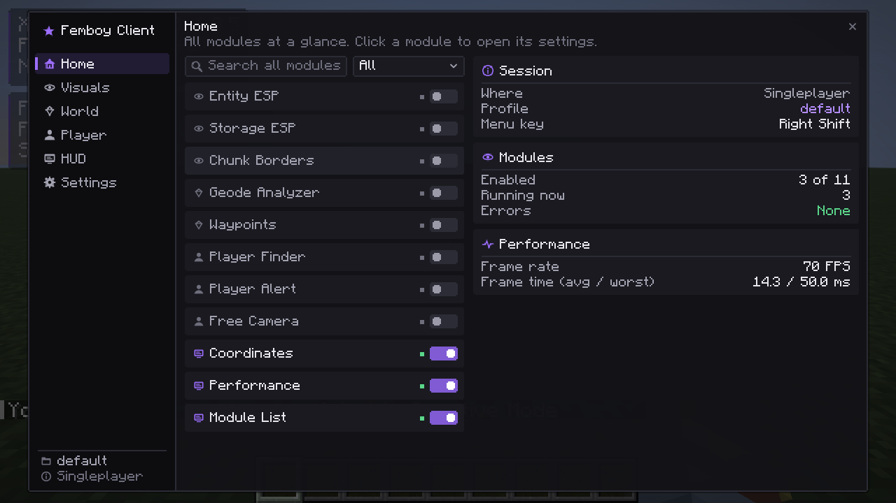

# Femboy Client

A client-side Fabric mod for **Minecraft Java Edition 1.21.11**: a clean ClickGUI with configurable visual, world, player and HUD modules.

Every module works everywhere: in singleplayer and on any server. Femboy Client contains nothing that hides it from anti-cheat systems, and some servers' rules forbid clients like this, so check before you use it there.



## Versions

| Component | Version |
|---|---|
| Minecraft | 1.21.11 |
| Fabric Loader | 0.19.5 |
| Fabric API | 0.141.6+1.21.11 |
| Fabric Loom | `net.fabricmc.fabric-loom-remap` 1.18.4 |
| Mappings | Mojang official mappings |
| Gradle | 9.7.1 (wrapper and distribution checksums pinned) |
| Java | 21 for compiling and running the game; Gradle itself needs **JDK 25+** (a Loom 1.18 requirement) |

## Installation (normal Minecraft launcher)

1. Install Fabric Loader 0.19.5 for Minecraft 1.21.11.
2. Put `femboy-client-0.4.0.jar` (from `build/libs/`) and Fabric API 0.141.6+1.21.11 into the profile's `mods` folder.
3. Start the game and press **Right Shift** to open the menu. You can rebind it under Options → Controls → Key Binds → Femboy Client.

Settings live in `config/femboyclient/`:
- `femboyclient.json`: client options, active profile
- `profiles/*.json`: modules, keys and settings per profile

Every file is written atomically with a `.bak` copy. An unreadable file is moved aside as `*.corrupt-<time>`, never deleted, and the client falls back to the backup or to defaults.

**Upgrading from NOVA:** on first launch, settings from `config/nova/` are copied to `config/femboyclient/`. The old folder is left untouched.

## Building

You need a JDK 25 or newer to run Gradle. The build uses a Java 21 toolchain for compiling and for the game: Gradle finds an installed JDK 21 or downloads one through the foojay resolver.

```bash
export JAVA_HOME=$HOME/.local/share/jdks/jdk-25.0.4.1+1   # any JDK 25+
```

| Task | Command |
|---|---|
| Build the mod jar (also runs the unit tests) | `./gradlew build` → `build/libs/femboy-client-0.4.0.jar` |
| Unit tests only | `./gradlew test` |
| Server GameTests, headless (includes the research experiment) | `./gradlew runGameTest` |
| In-game client tests, headless (needs `xvfb-run`), with screenshots | `./scripts/run-client-tests.sh` |
| Same, in a visible window | `./scripts/run-client-tests.sh --visible` |
| Launch a development client to play | `./gradlew runClient` |
| Copy the latest screenshots and reports into `docs/` | `./scripts/collect-artifacts.sh` (run directly after the client tests: other Gradle tasks clear the client run folder) |

## Using the menu

The sidebar has eight sections. Every module has an on/off switch, a key bind (click it and press a key; Backspace clears it), settings grouped into sections with tooltips and per-setting reset, and a module reset.

| Section | Contents |
|---|---|
| **Home** | Search across all modules with a category filter (click a module to open it), session status, module health, frame rate |
| **Combat** | Auto Attribute Swap |
| **Visuals** | Entity ESP, Storage ESP, Trackers, Fullbright, Free Camera, Chunk Borders |
| **World** | Geode Analyzer, Waypoints |
| **Player** | Player Finder, Player Alert |
| **HUD** | Coordinates, Performance, Module List |
| **Developer** | Java Runner |
| **Settings** | General tab: profiles, client options (menu scale, animations, tooltips), config folder. Diagnostics tab: frame timing, time per module, message log |

### Modules

| Module | What it does |
|---|---|
| **Auto Attribute Swap** | Switches to the right weapon for a single hit and straight back: an axe against a raised shield, a mace while falling, and optional spear, sword, trident and custom-item rules, each with its own cooldown and conditions. See below. |
| **Entity ESP** | Highlights the entity types you choose (picked by registry id in a searchable checklist). Compact labels with separately sized name, distance and health, outlines with real thickness and opacity per category, tracer lines, color overrides for chosen types. See below. |
| **Storage ESP** | Highlights storage blocks you choose by block id: chests and copper chests, trapped chests, ender chests, barrels, shulker boxes, hoppers, dispensers/droppers/crafters, furnaces, and other storage. Options: outline, fill, through walls, labels, built-in or custom colors per group, maximum distance, scan interval, maximum highlights. Reads only block entities your client has already received. |
| **Trackers** | Arrows at the screen edge pointing at players, mobs, waypoints and last-seen positions, labelled with where the position comes from. See below. |
| **Fullbright** | Lights up dark areas without changing your video settings, with adjustable intensity. |
| **Free Camera** | Fly the camera with its own rotation while your player stays put. Works on servers. See below. |
| **Chunk Borders** | Chunk boundary lines around you. |
| **Geode Analyzer** | Finds amethyst geodes in loaded chunks and keeps exact growth-stage counts up to date as chunks load and buds grow. See below. |
| **Waypoints** | Save positions; see them as markers with names and distances. |
| **Player Finder** | Online players from the server's player list (name, game mode, ping) with search and sorting, plus navigation to players in range and to your waypoints. See below. |
| **Player Alert** | Warns you when another player comes within your render distance: chat message, sound and/or pop-up, optionally also when they leave. See below. |
| **Coordinates, Performance, Module List** | HUD panels. |
| **Java Runner** | Write and run small Java programs in a separate process, with output, errors, limits and examples. See below. |

An enabled module **pauses** while no world is loaded and resumes on its own. If a module throws an error, it is turned off and reported under Settings → Diagnostics; other modules keep running.

### Geode Analyzer

- **Reads only what your client has.** It never loads chunks or asks the server for anything. Chunks in range that aren't loaded are reported as unavailable, never treated as empty.
- **Updates automatically.** New chunks are read when they load; already-read chunks are re-read after the scan interval; grouping into geodes runs in the background and only when the data actually changed. Reading is limited to a few milliseconds per tick. **Pause** stops reading and analysis while keeping the last results; **Read again** forces a fresh read.
- **Per geode:** distance and direction, completeness, a stage bar, counts per stage (with percentages of the geode's total buds and clusters), the sample size `n`, when the data was read, and an evidence-quality rating (based on completeness and sample size; it is *not* a probability). Click a geode for exact counts, budding faces, unavailable positions and Wilson intervals.
- **Settings:** analysis radius, scan interval, minimum observations, percentage display, listing incomplete geodes, growth-stage display in the world, progress on HUD, debug information, time per tick.
- **Interpretation:** the panel quotes what controlled tests showed (below) and states that growth stages are not evidence of player activity. It never labels a geode as "visited" or similar.

### Player Finder

- The list comes from the server's player list (everyone online, wherever they are).
- **Positions are known only for players within your range**: the server sends a player's position only while they are within its entity tracking range, roughly your render distance. Nothing on the client can see further; that would need the server to share positions.
- Players out of range show **"Position unknown"**, or, if they were in range earlier, **"Last seen … ago"** with that old position, clearly marked as stale. Nothing is inferred or invented. Last-seen positions are forgotten when you change world or dimension.
- Click a player with a known position, or one of your waypoints, to navigate: the HUD shows the target, distance and an arrow relative to where you're looking.

### Player Alert

- Turn it on in Player → Player Alert. It warns when a player comes within your range, i.e. when the server starts sending you that player.
- **Settings:** chat message (only you see it), sound, pop-up, warn when they leave (and whether they logged off), ignore NPCs (player-shaped entities missing from the server's player list), and a repeat delay so someone walking along the edge of your range doesn't flood the chat.
- Players already near you when you turn it on are not announced. Several arrivals in the same moment are combined into one message.

### Auto Attribute Swap

- **What it does:** when you attack, it selects the hotbar slot of a weapon chosen by rule, the attack is sent with that item, and the original slot is selected and sent again in the same tick. The server applies the hit with the swapped item's effects and never sees the swap during its own tick, so your attack charge is kept.
- **Rules,** checked in this order, each in its own card with the item icon, an on/off switch, a reset button and its settings:

  | Rule | Default | Condition | Cooldown |
  |---|---|---|---|
  | Axe | on | only against a raised shield (switchable) | 1000 ms |
  | Mace | on | after falling at least 1.5 blocks | 0 ms |
  | Spear | off | any hit | 500 ms |
  | Sword | off | any hit | 0 ms |
  | Trident | off | any hit | 500 ms |
  | Custom items | off | items you pick from a searchable list | 500 ms |

  Every rule can also be limited to players or to mobs.
- **Global settings:** swap-back delay (0 ticks by default), no swapping while using an item, status on the HUD.
- **Safety:** only hotbar slots are used and nothing is moved in your inventory. A missing item is skipped, a swap is never stacked on one that is still waiting to be undone, and if you change slots yourself during a delayed swap-back your choice is kept.
- **What "confirmed" means:** the panel shows the last swap, which slot was selected and sent, and whether it was held during the hit. Servers don't acknowledge slot changes, so the panel never claims more than that.

### Entity ESP

- **Sections:** Targets, Boxes, Colors, Labels, Health, Tracers, Performance.
- **Labels** are small by default (names at 0.75x). Name, distance and health each have their own on/off switch and size. Background opacity, padding, line spacing, text color and maximum name width (long names end in "...") are adjustable. Names use the group color instead of the old underline. Labels of entities close together stack instead of overlapping.
- **Health** is off by default. When on, it is shown for the groups you choose (players and hostile mobs by default) as a compact bar, a number, or both, with its own size and opacity.
- **Outlines:** thickness (0.5x to 6x), opacity, and an on/off switch per group. The thickness goes into the line shader, so the slider really changes the drawn line.
- **Tracers:** optional lines from the middle of your view to each highlighted entity, with their own thickness and opacity.
- **Color override:** pick entity types to draw in one override color instead of their group color.

### Trackers

- **Display:** an arrow at the screen edge for each target that is off screen, and a small marker for targets that are on screen. Labels show the name, distance and source.
- **Sources:**
  - entities your client has loaded (live positions);
  - your waypoints in this world and dimension;
  - Player Finder's last-seen positions, labelled "last seen ... ago".

  Nothing is shown for players that were never in your range.
- **Settings:** target types, maximum distance and number of indicators, update interval, indicator size, distance from the screen edge, labels, distance, label size, opacity, and a color per source.
- Targets that despawn or log off disappear at the next update; removed entities are skipped immediately.

### Free Camera

- **Rotation:** the camera has its own rotation, so the mouse turns the camera and your player's head stays where it was.
- **Keys:** forward, back and sideways use your normal movement keys. Up, down and boost have their own key settings (Space, Left Shift, Left Ctrl by default).
- **Movement settings:** speed, boost multiplier, smoothing, and "fly where you look".
- **On servers:**
  - your player keeps sending its normal position updates, so nothing snaps back when the camera returns;
  - attacking, using items and pick-block are disabled while the camera is detached, because they would aim from the camera.
- **Edge of the loaded area:**
  - the server only sends chunks around your player, so far away there is nothing to show;
  - the HUD says "No world data here" when the camera is there;
  - "Stay inside loaded chunks" stops the camera at the edge instead.
- **Restoring:** occlusion culling is switched off while the camera is detached (inside blocks it would hide everything) and restored afterwards, along with the camera type and the player's input. Dimension changes and respawns re-attach the camera cleanly.

### Java Runner

- **Editor:**
  - code editor with Java syntax highlighting, line numbers, selection, undo, copy, cut, paste and automatic indentation;
  - Run, Stop, Clear and Copy buttons;
  - six examples;
  - status line with the run time;
  - console with errors in red.
- **Never inside Minecraft:** each run starts a separate Java process with a memory limit, a time limit and an output limit, and Stop kills it. The game keeps running normally meanwhile.
- **What code can read:** a read-only snapshot taken when you press Run, through `Femboy.*`:
  - client and Minecraft versions, frame rate, connection;
  - every module's state and settings, recent diagnostics.

  It has no access to the game, your world or other players. Code that tries to use Minecraft classes fails to compile.
- **Code you write:** plain statements (wrapped automatically; `java.util.*` is imported) or a class with `main`. Errors show the line you typed.
- **Confirmation:** code that deletes or writes files, starts programs, uses the network, exits the process or bypasses access checks needs an extra confirmation before it runs. This is a safety prompt, not a sandbox: the process runs with your normal permissions.
- **A JDK is needed:** the runner needs a Java with a compiler. If the Java Minecraft runs on has none (the launcher's often doesn't), set "Java for the runner" to a JDK 21+.

## Research background

The Geode Analyzer grew out of controlled experiments run by `./gradlew runGameTest`. Full report: [docs/research/evaluation.md](docs/research/evaluation.md).

- **Setup:** vanilla geodes in a flat test world, growth simulated with the game's own random-tick code, scored on held-out geodes against criteria fixed before the experiment.
- **Results:**
  - The cluster share separated under 2 h from 2 h+ of simulated ticking. The current report shows 2.2% false positives and 2.9% false negatives on 194 held-out samples; across three runs, the ranges were 2–7% and 3–5%.
  - It cannot separate 5–24 h from longer: the share saturates near 100% after about 6 h.
  - World generation already places clusters, so "any cluster" is not informative (87% false positives).
  - Harvesting resets the share.

None of this identifies players. It describes simulated ticking in test worlds.

## Project layout

```
src/main/java/.../femboyclient/core/     plain Java: settings, modules, config, diagnostics, research, Java Runner process (unit-tested)
src/main/java/.../femboyclient/world/    shared Minecraft code: geode fixtures, census, server scan, experiment generator
src/client/java/.../femboyclient/client/ client: entrypoint, GUI, HUD, rendering, modules, mixins
src/gametest/java/                       server GameTests and in-game client tests
src/test/java/                           JUnit tests
tools/make_icons.py                      generates the GUI icon atlas
scripts/                                 test runner and artifact collection
docs/                                    screenshots, test reports, research reports, verification report
```

Adding a module means writing one class (settings are declared as fields) and one line in `ModuleRegistry`. The GUI builds its page entry, settings panel and persistence from the module's category and settings.

Mixins (nine, each documented in its source file):
- **`KeyboardHandlerMixin`:** module key binds. Fabric API has no in-world key event, and polling once per tick misses short taps.
- **`GameRendererMixin`:** hides the first-person hand while the free camera is active.
- **`LocalPlayerMixin`:** keeps your player sending position updates while the free camera is active (vanilla stops them whenever another entity is the camera).
- **`MinecraftMixin`:** blocks attack, use and pick-block while the free camera is active, since vanilla would aim them from the camera.
- **`MouseHandlerMixin`:** sends mouse movement to the free camera instead of the player.
- **`LightTextureMixin`:** Fullbright's brightness, applied to the lightmap only (the video setting is never written).
- **`MultiPlayerGameModeMixin`** and **`MultiPlayerGameModeAccessor`:** Auto Attribute Swap's slot change around one attack.

## Documentation

- [docs/VERIFICATION.md](docs/VERIFICATION.md): what was verified, how, and what wasn't.
- [KNOWN_ISSUES.md](KNOWN_ISSUES.md): known limitations and unverified assumptions.
- [CHANGELOG.md](CHANGELOG.md)

## License

Not decided yet (`All-Rights-Reserved` in `fabric.mod.json` until the author chooses one).
